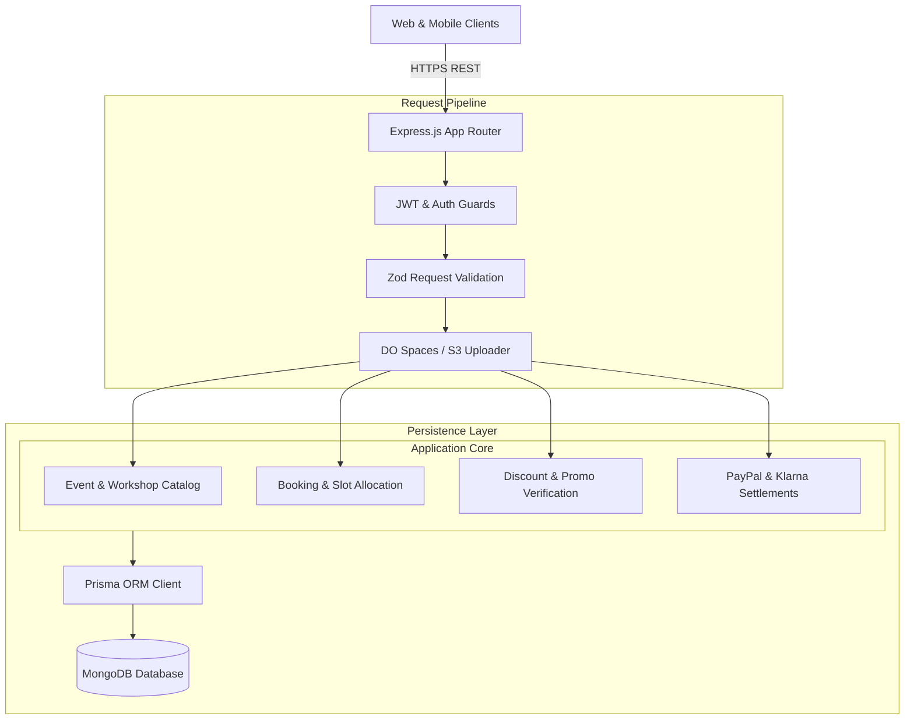

# Darias Design Backend - Creative Events & Workshop Booking API

<p align="center">
  
</p>

<p align="center">
  <a href="https://nodejs.org"></a>
  <a href="https://expressjs.com"></a>
  <a href="https://www.typescriptlang.org"></a>
  <a href="https://www.prisma.io"></a>
  <a href="https://www.mongodb.com"></a>
  <a href="https://www.paypal.com"></a>
  <a href="LICENSE"></a>
</p>

---

## 📖 Overview

**Darias Design Backend (`dariasdesign_backend`)** is a dedicated event ticketing, creative design studio workshop, and exhibition booking RESTful API. Built with Express.js, TypeScript, and Prisma ORM with MongoDB, the API coordinates event scheduling, dynamic slot capacity, multi-tier ticket sales, multi-participant group bookings, discount coupon validations, and checkout via PayPal, Klarna, and bank transfers.

---

## ⚡ Key Features

- **🎨 Creative Workshops & Exhibition Showcase:** Dynamic event catalogs managing hero banners, gallery sliders, overlapping artwork imagery, and content summaries.
- **🎟️ Dynamic Time Slots & Ticket Inventory:** Granular scheduling for start/end times with automated slot capacity decrementing.
- **👥 Multi-Participant Group Bookings:** Full participant rosters capturing names, contact details, company information, and filming/videography permissions.
- **💳 Multi-Gateway Payment Processing:** Built-in support for PayPal Checkout Server SDK, Klarna payment flows, and manual bank transfers.
- **🏷️ Promotional Coupons & Discounts:** Date-bounded discount code verification with percentage and fixed price deduction logic.

---

## 🏗️ System Architecture



---

## 🗂️ Project Structure

```
dariasdesign_backend/
├── assets/
│   └── banner.svg               # Architectural repository banner
├── prisma/
│   └── schema.prisma            # MongoDB schema definitions
├── src/
│   ├── app/
│   │   ├── modules/             # Auth, User, Event, Slot, Ticket, Booking, Discount
│   │   ├── middlewares/         # Auth, validation, error handling
│   │   └── routes/              # Central route index
│   ├── config/                  # Environment variables & PayPal config
│   ├── helpers/                 # DigitalOcean Spaces, JWT, encryption
│   ├── app.ts                   # Express application setup
│   └── server.ts                # HTTP server bootstrapper
├── package.json
└── tsconfig.json
```

---

## 🛠️ Tech Stack

| Technology | Purpose |
| :--- | :--- |
| **Node.js & Express 4** | Backend HTTP API runtime |
| **TypeScript 5** | Strong typing and interface contracts |
| **Prisma ORM 6** | MongoDB document modeling and migrations |
| **MongoDB** | Database for workshops, tickets, bookings, and users |
| **PayPal Checkout SDK** | Payment checkout processing |
| **BullMQ & Redis** | Asynchronous task queue and email confirmations |
| **DigitalOcean Spaces** | Cloud object storage for event banners |

---

## 🚀 Getting Started

### Prerequisites

- Node.js >= 20.0.0
- MongoDB instance (MongoDB 6+)
- Redis instance
- npm or yarn

### Installation

1. Clone the repository:
   ```bash
   git clone https://github.com/shahjalal-labs/dariasdesign_backend.git
   cd dariasdesign_backend
   ```

2. Install dependencies:
   ```bash
   npm install
   ```

3. Configure environment variables:
   ```bash
   cp .env.example .env
   ```

4. Generate Prisma Client:
   ```bash
   npx prisma generate
   ```

5. Run development server:
   ```bash
   npm run dev
   ```

---

## 📄 License

This project is licensed under the [ISC License](LICENSE).
